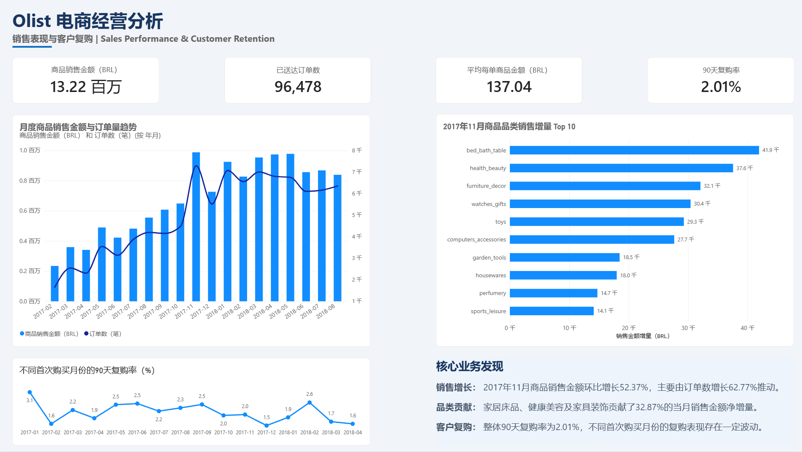
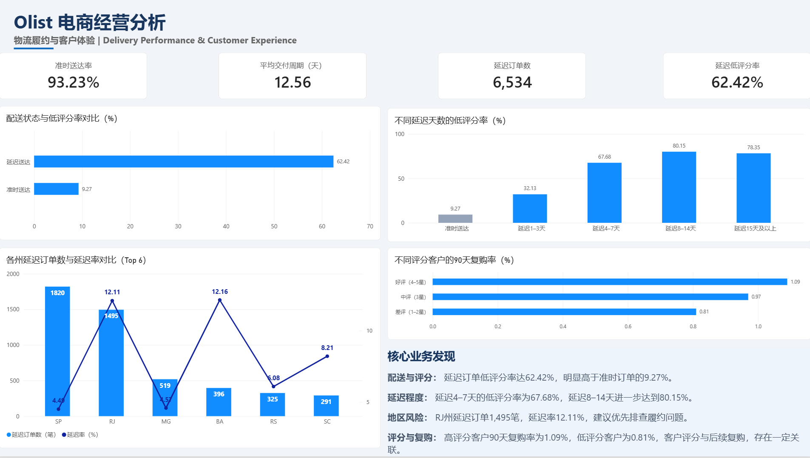

# Olist E-Commerce Analytics | 电商经营与客户体验分析

**SQL · Python · Pandas · SQLite · Power BI · Cohort Analysis · Statistical Testing**

> An end-to-end e-commerce analytics portfolio project using the public **Olist Brazilian E-Commerce Dataset**. It examines sales growth drivers, short-term customer repeat purchase, fulfillment delays, review scores, and operational priorities.
>
> 基于 Olist 巴西电商公开数据，使用 Python/SQL 完成数据质量检查、多表整合、销售增长拆解、90 天复购分析、履约与评价分析，并在 Power BI 中制作两页业务看板。

## Dashboard / 可视化看板

### Page 1 — Sales Performance & Customer Retention / 销售表现与客户复购



### Page 2 — Delivery Performance & Customer Experience / 物流履约与客户体验



> **Editable Power BI report / 可编辑 Power BI 报表**  
> 📥 **[Download the complete Power BI report (.pbix) / 下载完整 Power BI 报表](./Olist_电商经营与客户体验分析.pbix)**  
> Open the downloaded file with **Power BI Desktop** to explore both report pages. If your local data folder differs from the original creator's environment, update the CSV data-source paths using Power Query. All ten aggregated source tables are included in [`powerbi_data/`](powerbi_data/).
>
> **说明：** 两页看板截图可直接在 GitHub 预览；可编辑的 `.pbix` 原文件已上传。下载后使用 Power BI Desktop 打开，如出现数据源路径提示，可将其重新指向本仓库的 `powerbi_data/` 文件夹。

## Key business findings / 核心业务发现

| Analysis area / 分析方向 | Key finding / 核心结果 |
|---|---|
| Sales baseline / 经营基线 | **96,478** delivered orders; **R$13.22M** item sales (excluding freight); **R$137.04** item amount per delivered order |
| November growth / 11 月增长拆解 | Nov 2017 item sales **+52.37% MoM**, order count **+62.77%**, average item amount per order **−6.39%** |
| Category contribution / 品类贡献 | Bed & Bath, Health & Beauty, and Furniture & Decor contributed **32.87%** of the *net item-sales increase* in Nov 2017 |
| 90-day retention / 90 天复购 | **2.01%** among **75,320** customers with a complete 90-day follow-up window |
| Delivery operations / 履约时效 | **93.23%** on-time rate, **12.56 days** average purchase-to-delivery time; **6,534** delayed orders |
| Reviews / 配送与低评分 | Low-score share (1–2 stars): **62.42%** among reviewed delayed orders vs **9.27%** among reviewed on-time orders |
| Delay severity / 延迟程度 | Low-score share reached **67.68%** for 4–7-day delays and **80.15%** for 8–14-day delays |
| Regional prioritization / 地区优先级 | RJ: **1,495** delayed orders and **12.11%** delay rate; SP: **1,820** delayed orders and **4.49%** delay rate |
| Reviews & repeat / 评分与复购 | 90-day repeat: **1.09%** for high-score vs **0.81%** for low-score groups (**0.28 percentage-point** gap) |

### Business recommendations / 业务建议

1. **Identify operational bottlenecks in RJ:** its combination of meaningful delayed-order volume and above-average delay rate warrants investigation before launching any intervention.
2. **Monitor delay severity:** prioritize high-risk 4+ day delays, where low review scores are particularly common.
3. **Improve repeat-purchase measurement:** monitor 90-day customer cohorts rather than relying on lifetime repeat rates vulnerable to unequal follow-up times.
4. **Validate causal impact separately:** all delay–review and review–repurchase findings are observational associations, not evidence of causation.

## Methods / 分析方法

**Data preparation:** load and validate seven relational CSV tables; check identifiers, joins, nulls, and duplicate-grain risks. Use Pandas and an in-memory SQLite database.

**Sales diagnostics:** delivered-order item sales, order count, average item amount per order, month-over-month decomposition, and category contribution to net sales growth.

**Customer behavior:** distinct customer identification (`customer_unique_id`), overall repeat-purchase frequency, complete-window 90-day cohort retention, and first-review-to-repeat association.

**Delivery & review analysis:** purchase-to-delivery duration, expected-vs-actual delivery lateness, 1–2-star low-review share, delay-day bands, and state-level comparison.

**Statistical check:** chi-square test for association between first-order review group and repeat purchase within 90 days (**p ≈ 0.033**). The absolute difference is small; no causal interpretation is claimed.

## Repository structure / 仓库结构

```text
.
├── README.md
├── Olist_电商经营与客户体验分析.pbix    # Editable Power BI dashboard / 完整报表
├── notebooks/
│   └── Olist_Analysis.ipynb       # Python + SQL full analysis
├── powerbi_data/                 # 10 aggregated CSV tables for Power BI
│   ├── 01_总体经营KPI.csv
│   ├── ...
│   └── 10_评分与评价后90天复购.csv
├── screenshots/
│   ├── 01_sales_and_retention.png
│   └── 02_delivery_and_experience.png
├── docs/
│   ├── metric_definitions.md
│   └── dashboard_build.md
├── data/
│   └── README.md                # How to obtain original public CSVs
├── requirements.txt
└── .gitignore
```

## Reproduce / 复现步骤

1. Download the original seven relevant CSVs from [Olist Brazilian E-Commerce Public Dataset (Kaggle)](https://www.kaggle.com/datasets/olistbr/brazilian-ecommerce). Place them inside the repository's `data/` directory using their original filenames (see [`data/README.md`](data/README.md)).
2. Install dependencies: `pip install -r requirements.txt`.
3. Open [`notebooks/Olist_Analysis.ipynb`](notebooks/Olist_Analysis.ipynb) with Jupyter Notebook / JupyterLab; run all cells from top to bottom.
4. The analysis shows SQL-driven metrics, cohort analysis, customer review comparisons, and the association test.
5. **Open the completed report:** download [`Olist_电商经营与客户体验分析.pbix`](./Olist_电商经营与客户体验分析.pbix) and open it in **Power BI Desktop**. If Power BI prompts for missing local CSV paths, repoint them to the files in [`powerbi_data/`](powerbi_data/), then refresh.
6. **Rebuild or customize the visuals:** import the ten aggregated tables from [`powerbi_data/`](powerbi_data/) and follow [`docs/dashboard_build.md`](docs/dashboard_build.md).

**Important data definitions:** sales here means sum of `order_items.price` for delivered orders (excluding shipping/freight and costs), **not** audited revenue or profit. Core delivery-rate denominators exclude records missing required actual delivery dates; review-based rates use reviewed orders. Monthly trends and 90-day cohorts use different, explicitly stated observation windows.

## Tools / 技术栈

`Python` · `Pandas` · `SQL (SQLite)` · `SciPy` · `Power BI` · `DAX` · `Jupyter Notebook`

## Source and limitations / 数据来源与局限

**Source:** [Olist Brazilian E-Commerce Public Dataset](https://www.kaggle.com/datasets/olistbr/brazilian-ecommerce).

- Original data are public historical e-commerce records; they do not represent current real-time business performance.
- This public portfolio excludes raw customer-level records. Download the original dataset separately to reproduce.
- The growth contribution values are net item-sales contributions, not profits or promotion attribution.
- Complete-window 90-day repeat rates avoid some end-of-dataset observation bias; they do not establish customer lifetime value.
- Chi-square significance does not imply a large practical effect, and observational associations cannot prove causal pathways.
